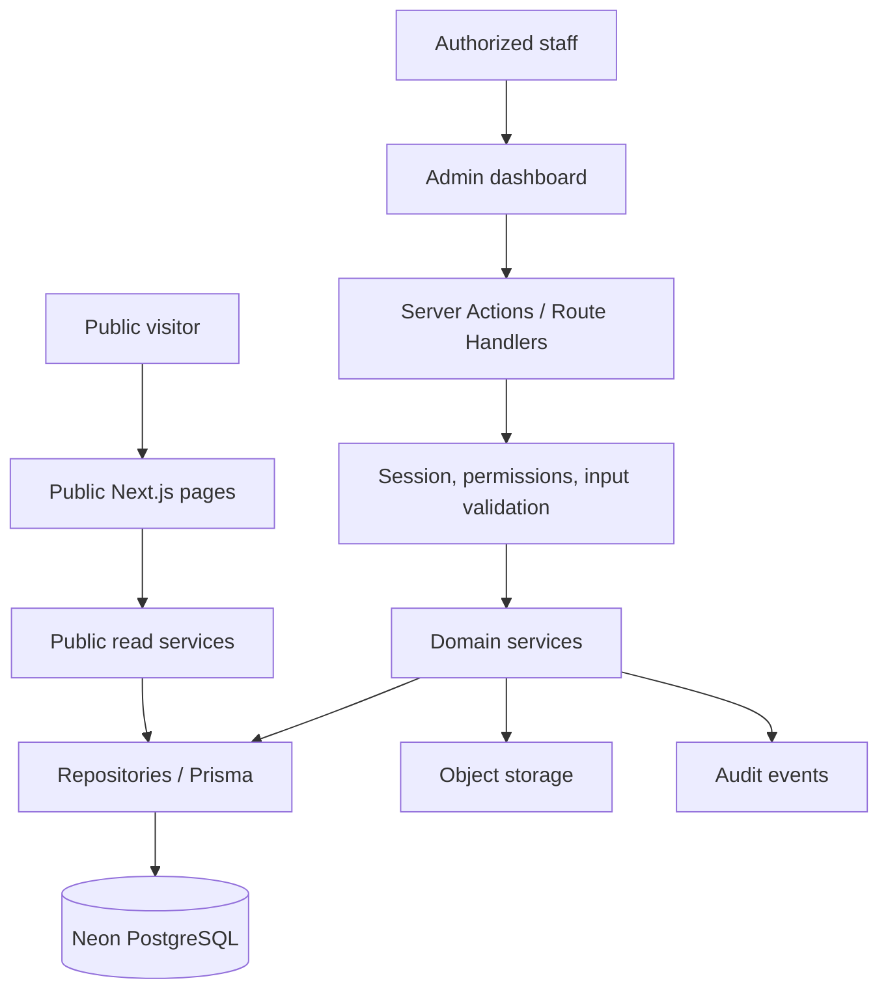

# Architecture and boilerplate specification

## Implementation decisions

The implementation uses a shared ContentRecord/ContentRevision model for pages, departments, people, positions, FAQs, and albums. Each module has a validated, allowlisted payload and indexed relational fields for title, ordering, membership, advisory placement, deadlines, and publication state. Department links and image references are normalized foreign-key tables scoped to revisions. This keeps publishing, archive/restore, concurrency, and audit rules consistent across modules while retaining typed validation at the server boundary.

Achievements retain a dedicated revision model with normalized ordered author and department relations. The original Department table remains as a migration compatibility source; active department editing uses ContentRecord. Core page slugs stay fixed; other slug changes occur on publication and maintain stable-record redirects.

Media is uploaded through a bounded authenticated server endpoint, decoded and normalized with Sharp, and stored privately through a local-development or S3-compatible driver. The app checks publication references before serving image bytes. This replaces the earlier proposed signed-upload/finalization workflow with a single bounded server upload; no public bucket is required.

Authentication uses Better Auth with database-backed rate limits. Staff onboarding/recovery uses owner-issued, expiring, hashed single-use links delivered by the owner through their chosen channel. No outbound email service is assumed. See SETUP.md for operation and VERIFICATION.md for evidence.

## Architecture decision

Use a modular monolith: one repository and one Next.js application with distinct presentation, server entry-point, service, and persistence layers. The public website and admin dashboard share domain logic and Neon PostgreSQL.

Next.js supports backend request handlers within the application. Server-rendered components should read through the service layer directly instead of making HTTP calls back into the same application. See the official [backend-for-frontend guide](https://nextjs.org/docs/app/guides/backend-for-frontend).



This preserves MERN-style separation while using React within Next.js and PostgreSQL in place of MongoDB. A separate Express server is unnecessary for the planned scope. Long-running imports or media processing, if added later, belong in a worker/job service.

## Proposed technology baseline

| Concern | Choice or selection rule |
| --- | --- |
| Application | Next.js App Router with TypeScript in strict mode |
| Runtime | Supported Node.js LTS compatible with the selected Next.js release |
| UI | React, Tailwind CSS, reusable accessible components; shadcn/ui proposed |
| Persistence | Neon PostgreSQL |
| ORM | Prisma with committed migrations |
| Validation | Zod schemas shared where appropriate; server validation mandatory |
| Forms | Native forms/Server Actions; React Hook Form for complex interactive forms if useful |
| Authentication | Maintained Next.js-compatible authentication library/provider; choose after institutional sign-in requirements are known |
| Media | S3-compatible object storage or managed image provider; provider selected before uploads are implemented |
| Testing | Unit/integration test runner plus Playwright for critical browser flows |
| Tooling | One package manager and committed lockfile, ESLint, formatter, CI |
| Deployment | Node-compatible Next.js host, separate preview/production configuration |

Pin exact versions during scaffolding after checking compatibility. Do not copy version-specific auth, caching, or Prisma configuration from this planning document; it specifies behavior rather than version-specific APIs.

Neon's Prisma guidance recommends pooled application connections and describes its serverless adapter setup. Configure runtime and migration connectivity according to the versions chosen during scaffolding. See [Neon's maintained Prisma guide](https://github.com/neondatabase/website/blob/main/content/docs/guides/prisma.md).

## Planned folder structure

This is the target boilerplate, not a claim that these files already exist.

```text
src/
  app/
    (public)/
      layout.tsx
      page.tsx
      about/page.tsx
      policies/page.tsx
      achievements/[slug]/page.tsx
      achievements/page.tsx
      research/[slug]/page.tsx
      research/page.tsx
      advisory-panel/page.tsx
      members/[slug]/page.tsx
      members/page.tsx
      recruitment/[slug]/page.tsx
      recruitment/page.tsx
      gallery/[slug]/page.tsx
      gallery/page.tsx
      contact/page.tsx
    (auth)/login/page.tsx
    admin/
      layout.tsx
      page.tsx
      pages/
      achievements/
      departments/
      people/
      recruitment/
      gallery/
      media/
      settings/
      users/
      activity/
    api/
      auth/                     # Provider-specific route when required
      uploads/                  # Authorized upload initiation/finalization
      health/route.ts
    layout.tsx
    error.tsx
    not-found.tsx
    robots.ts
    sitemap.ts
  components/
    ui/
    layout/
    admin/
  features/
    achievements/
      components/
      schemas.ts
      types.ts
    people/
    departments/
    pages/
    recruitment/
    gallery/
  server/
    actions/                    # Thin validated mutation entry points
    services/                   # Permissions, business rules, transactions
    repositories/               # Database queries and explicit projections
    auth/                       # Session lookup and permission helpers
    db/                         # Shared database client
    storage/                    # Object-storage abstraction
    audit/
  lib/
    env.ts
    constants.ts
    utils.ts
  styles/globals.css
prisma/
  schema.prisma
  migrations/
  seed.ts
tests/
  integration/
  e2e/
public/
docs/
.env.example
.gitignore
package.json
```

Route groups such as `(public)` do not become URL segments. Admin modules receive their list, create, and edit pages as each feature is implemented. Place server-only guards on modules that access credentials or persistence.

## Backend conventions

- Server Components handle public reads through public service methods that return only published, permitted fields.
- Server Actions handle ordinary admin form submissions. Route Handlers serve uploads, authentication callbacks, or explicit external HTTP integrations.
- Both entry-point types call the same services. Do not duplicate permission or publication rules in UI code.
- Services enforce identity and role checks, business rules, transactions, and audit recording. Repositories perform bounded database operations.
- Validate payloads and query parameters on the server. Use field allowlists to prevent mass assignment.
- Use stable IDs internally and unique slugs publicly; retain redirects when a published slug changes.
- Return field errors and safe general errors; record diagnostic details privately with a request identifier.
- Bound pagination and filter inputs. Use optimistic concurrency to reject edits against an outdated revision.
- Publish data and its audit event in one database transaction, then invalidate affected public cache entries.
- Private previews and admin pages must not use shared public caches. Cache keys and invalidation account for entity, list, and related-page dependencies.

## Database model

All mutable domain records have an ID and timestamps. Content entities carry draft/published revision pointers and archive metadata. Detailed schema and constraints are implemented in Phase 2.

| Entity | Important fields and relationships |
| --- | --- |
| StaffUser | Auth identity reference, email, role, active flag; auth library owns its required session/account tables |
| SiteSettings | Singleton lab identity, logo asset, public contact details, social links, default SEO settings |
| Page | Unique key/slug, draftRevisionId, publishedRevisionId, archivedAt |
| PageRevision | Page ID, version, title, validated structured body, SEO, author, creation time |
| Department | Slug, revision pointers, display order; revision includes title, description, cover asset |
| Person | Slug, revision pointers; revision includes name, biography, affiliation, approved contact/links, portrait, advisor flag, membership category |
| MembershipCategory | Unique key, editable label, display order; five initial source categories |
| PersonDepartment | Person-to-department relationship, optional role; unique pair |
| Achievement | Slug, revision pointers; revision includes type, title, year, research status, abstract, venue, DOI/URL, patent-specific fields, public-disclosure approval |
| AchievementAuthor | Revision ID, optional person ID, author name snapshot, affiliation, display order; supports external coauthors |
| AchievementDepartment | Revision-to-department relation; unique pair |
| Position | Slug, revision pointers; revision includes title, department, eligibility, benefits, application instructions/link, deadline/timezone, open/closed state |
| FAQ | Recruitment section, question, answer, display order, publication revisions |
| Album | Slug, revision pointers; revision includes title, description, cover asset, event date |
| AlbumPhoto | Album revision ID, media asset ID, caption, alt text, display order |
| MediaAsset | Storage key, MIME type, byte size, dimensions, upload owner, public/private state |
| AuditEvent | Actor, operation, entity type/ID, timestamp, safe change summary; no secrets or unnecessary personal data |
| SlugRedirect | Old path, current entity/path; avoid redirect chains and loops |

Revision tables for Department, Person, Achievement, Position, FAQ, and Album follow the PageRevision pattern with typed domain fields. Relationships that affect published content must be revision-scoped; membership/department changes must not leak through to a live profile before publishing. Prefer normalized relational fields for filterable content and validated structured JSON only for rich-text bodies.

Publishing validates a complete revision and atomically changes the published pointer. Public joins resolve the published revisions of related records. Archiving removes content from public queries while retaining its history. Settings use an explicit save-and-publish operation with audit history; they do not silently participate in the editorial draft workflow.

### Constraints and indexes

- Unique slugs per public resource type; unique page keys and membership category keys.
- Foreign keys for all relations; restrict deletion of media and referenced content.
- Index achievement type/year/status and published pointers, person category/order, position state/deadline, and audit timestamp/actor.
- Enforce research status compatibility with achievement type; patent statuses are not journal statuses.
- Validate year ranges, HTTP/HTTPS links, author ordering, file limits, and maximum field lengths.
- Store timestamps in UTC; display using a configured lab timezone. If Asia/Dhaka is adopted, deadlines must explicitly show that timezone.
- Omit confidential fields from public projections, not merely from visible components.

## Permission matrix

| Action | Visitor | Editor | Admin | Owner |
| --- | --- | --- | --- | --- |
| Read published public content | Yes | Yes | Yes | Yes |
| Read private drafts/preview | No | Yes | Yes | Yes |
| Create/edit drafts and upload media | No | Yes | Yes | Yes |
| Publish/archive public content | No | No | Yes | Yes |
| Edit global settings | No | No | Yes | Yes |
| Read audit history | No | No | Yes | Yes |
| Invite/revoke staff and assign roles | No | No | No | Yes |

Authentication and authorization must be enforced inside server entry points/services. A protected layout or hidden button is insufficient, as the official [Next.js authentication guide](https://nextjs.org/docs/app/guides/authentication) explains. Prevent removal of the last active owner. Revocation must invalidate effective access, including existing sessions.

## Security and operations

- Use invitation-only staff access, established auth library session handling, and supported MFA for privileged accounts where available.
- Verify object-level access and roles for every write, draft read, and upload request.
- Sanitize rich content using an allowlist; do not allow arbitrary scripts, iframes, or executable MDX from admin input.
- Restrict uploads by size and actual file type; use randomized storage keys and expiring signed upload URLs. Keep unpublished/private assets private and issue authorized preview URLs.
- Publishing promotes approved assets to public delivery. Removing a public file requires an explicit retention/CDN policy because archived pages alone cannot recall downloaded assets.
- Enforce origin/CSRF protections for cookie-authenticated mutations according to the selected framework/auth setup; rate-limit login and uploads.
- Keep credentials server-only. Never prefix database, session, or storage secrets with `NEXT_PUBLIC_`.
- Use separate development, preview, and production databases/branches and storage namespaces. Preview must not mutate production.
- Apply committed migrations through controlled deployment; do not use schema push as the production migration workflow.
- Verify backup/restore capabilities and retention against the selected Neon plan; conduct a restore exercise before launch.
- Log errors and audit changes without exposing connection strings, tokens, or private draft bodies.

## Boilerplate acceptance contract

The eventual runnable starter must include environment validation, an example environment file with placeholders, ignored local secrets, database client and migration setup, repeatable seed data, auth/session integration, permission helpers, public/admin shells, loading/error/empty states, shared form validation, media interface, and CI scripts.

Expected scripts: `dev`, `build`, `start`, `lint`, `typecheck`, `test`, `test:e2e`, `db:generate`, `db:migrate`, `db:deploy`, and `db:seed`. Their exact commands depend on the chosen dependency versions.

Document required environment variables for database runtime/migration URLs, application origin, authentication, and storage. Bootstrap the first owner through a controlled setup procedure; never commit a default password or seed a shared production login.
